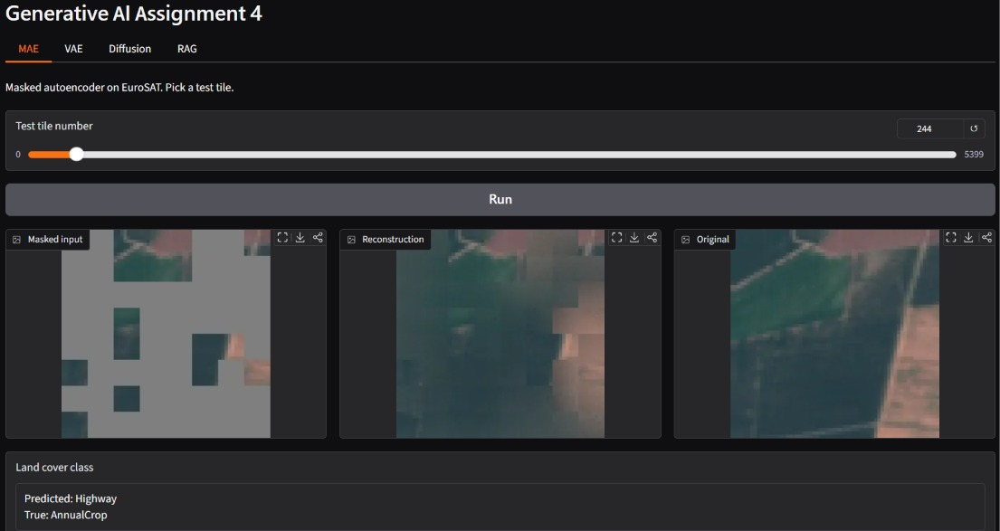
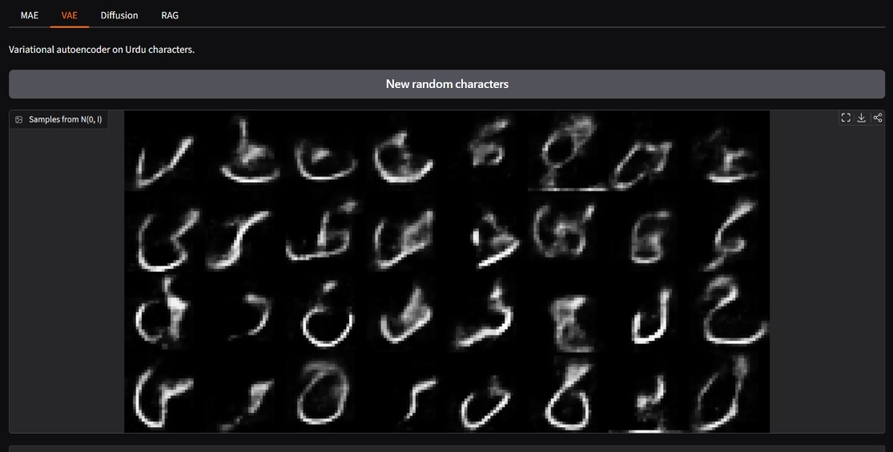
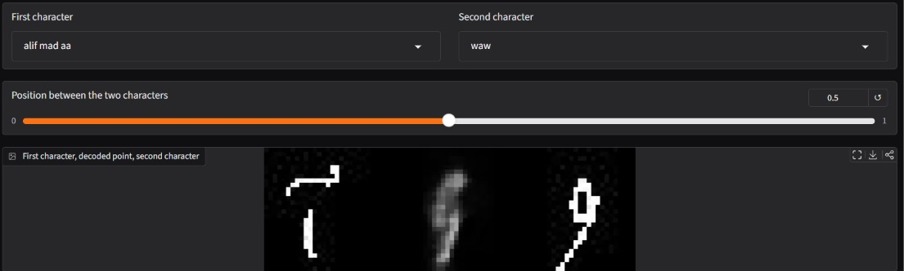
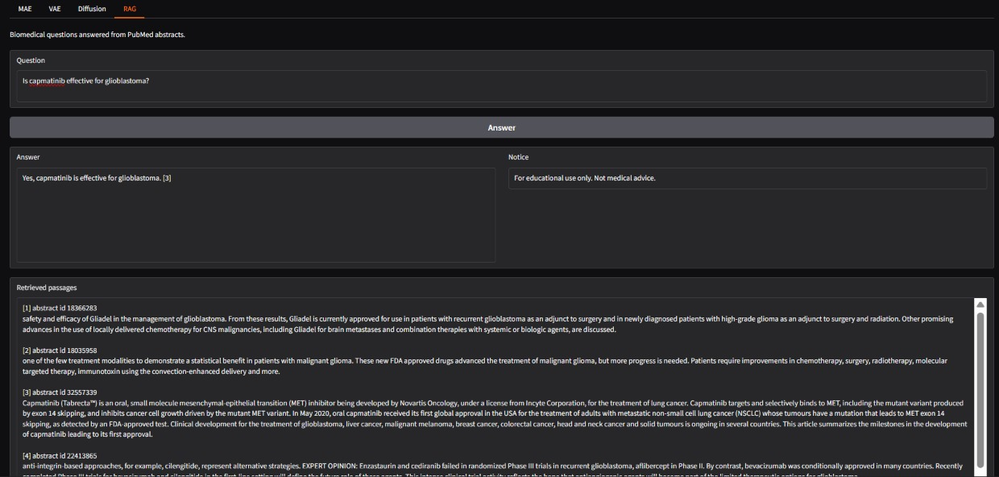

# Generative AI Assignment 4: Masked Autoencoder, VAE, Diffusion and RAG

Four generative models and one app for the Generative AI course (Fall 2026). This is a solo submission, not a group of two, so there is one author and one human evaluator.

- Medium blog: PASTE_BLOG_LINK_HERE
- LinkedIn post: PASTE_LINKEDIN_LINK_HERE
- Trained weights (Google Drive): PASTE_WEIGHTS_LINK_HERE

## What is in this repo

    starter/                  starter code from the assignment, unchanged
    part_a_mae/               mae_model.py (model and masked loss)
    part_b_vae/               vae_model.py (model and ELBO loss)
    part_c_diffusion/         ddpm.py (U-Net, noise schedule, noising, sampling)
    part_d_rag/               rag_utils.py (chunking, embedding, search, prompt, metrics)
    results/                  figures, tables, rag_answers.jsonl, human_eval.csv, samples.md, analysis.md
    app/                      app.py (Gradio app with four tabs)
    genai_assignment4.ipynb   all training and evaluation cells in order

The training loops and evaluation code are in the notebook, in the order Task 0, Part B, Part A, Part C, Part D, app.

## How to run

1. Put this repo in Google Drive as `MyDrive/genai_assignment4` and open `genai_assignment4.ipynb` in Colab. Use a T4 GPU for Parts A, C, D and the app.
2. Unzip the UHaT `data.zip` into `starter/data/uhat/`. EuroSAT and BioASQ download automatically.
3. Run the sections in order: Task 0, Part B, Part A, Part C, Part D. Restart the session between parts, because variable names are reused.
4. To skip training, download the weights from the link above and put them here: `part_a_mae/mae.pt`, `part_a_mae/clf.pt`, `part_b_vae/vae.pt`, `part_c_diffusion/ddpm.pt`, `part_d_rag/chunk_embeddings.pt`, `part_d_rag/chunks.json`.
5. App: run `pip install gradio diffusers` and then `python app/app.py`. In Colab it prints a public link. It loads all four models, so use a GPU.

## Results

Table 1: Data

| Item | Value |
|---|---|
| EuroSAT train / test images | 16,200 / 5,400 |
| Labelled images used | 160 (16 per class) |
| UHaT character classes | 40 |
| UHaT train / test images | 28,328 / 4,747 |
| BioASQ abstracts | 40,181 |
| Chunks | 79,332 |
| Test questions | 707 |
| Mean relevant abstracts per test question | 8.66 |

Table 2: Training

| Model | Parameters | Final training loss | Time / GPU |
|---|---|---|---|
| MAE (encoder + decoder), 100 epochs | 3,173,248 | 0.00561 (masked MSE) | 442 s, Colab GPU |
| VAE, 30 epochs | 220,385 | 130.60 (negative ELBO) | 736 s, on CPU (that session had no GPU) |
| DDPM U-Net, 40 epochs | 4,028,353 | 0.02289 (L_simple) | about 54 s per epoch on a Colab GPU, about 36 min in total, trained in two runs (epochs 1 to 16, then 17 to 40 in 1,315 s) |

Table 3: Image results

| Item | Value |
|---|---|
| MAE few-label classifier, test accuracy | 54.0% (chance is 10%) |
| VAE test negative ELBO | 131.03 nats = 105.54 reconstruction + 25.49 KL |
| Diffusion blind test, member 1 correct | 1 of 40 |
| Diffusion blind test, member 2 correct | not done (solo) |
| Images where both members agreed | not applicable (solo) |

Table 4: Retrieval (707 test questions)

| Hit@1 | Hit@5 | Hit@10 | Recall@1 | Recall@5 | Recall@10 | MRR@10 |
|---|---|---|---|---|---|---|
| 0.622 | 0.816 | 0.861 | 0.622 | 0.586 | 0.602 | 0.706 |

Table 5: Generation (first 100 questions)

| Item | Value |
|---|---|
| ROUGE-L | 0.221 |
| Citation precision | 0.654 (51 of 78 cited passage numbers) |
| "I don't know" rate | 0.13 (simple phrase match) |
| Human: supported, member 1 | 15 of 20 |
| Human: supported, member 2 | not done (solo) |
| Human: correct, member 1 | 15 of 20 |
| Human: correct, member 2 | not done (solo) |

## Figures

All figures are in `results/`.

- Part A: `mae_loss.png`, `mae_recon.png`, `mae_confusion.png`, `eurosat_examples.png`
- Part B: `vae_losses.png`, `vae_recon.png`, `vae_samples.png`, `vae_interpolation.png`, `uhat_examples.png`
- Part C: `diffusion_forward.png`, `diffusion_loss.png`, `diffusion_samples.png`, `diffusion_denoising.png`, `diffusion_blind.png`
- Part D: `rag_recall_at_k.png`
- Tables and answers: `rag_retrieval_table.json`, `rag_generation_table.json`, `rag_answers.jsonl`, `human_eval.csv`, `samples.md`, `analysis.md`

## Correctness checks

- MAE: exactly 48 of 64 patches masked in every image (min 48.0, max 48.0). The loss was 0.006640929728746414 both before and after ruining the visible-patch predictions, so the loss is computed only on masked patches.
- VAE: KL is 0 when mu = 0 and log sigma^2 = 0, and the smallest KL over all test images is 15.85, so it is never negative.
- DDPM: alpha_bar at t = 999 is 4.04e-5 (about 4e-5), and the noised image at t = 999 looks like pure noise (`diffusion_forward.png`).
- RAG: the longest chunk is 150 words. Embedding norms are between 0.9999998 and 1.0000001. A perfect retriever gives Hit@k = Recall@k = MRR@10 = 1.0 for k = 1, 5, 10.

## App screenshots

The RAG tab shows the notice "For educational use only. Not medical advice." next to every answer.

## Notes and deviations

- Solo submission. Human evaluation was done by one person, and the member 2 and agreement numbers are not available.
- The VAE trained on CPU because no GPU was available for that session.
- The MAE was trained for the full 100 epochs. An earlier 50-epoch run was overwritten by this one.
- The assignment does not fix some MAE details, so I chose: decoder feed-forward width 512, dropout 0, pre-norm transformer layers, raw pixel values as targets, and default AdamW weight decay for the linear classifier.
- The diffusion model was trained in two runs and resumed from a saved checkpoint, so the loss log covers all 40 epochs.
- The "I don't know" rate and the citation precision are computed by simple rules (phrase matching and passage-number parsing). Citation precision counts a cited passage as correct only if its abstract is in the BioASQ relevant list.
- Generation uses greedy decoding with repetition_penalty set to 1.0.
- Trained weights are not committed to GitHub. They are on Google Drive (link above).
